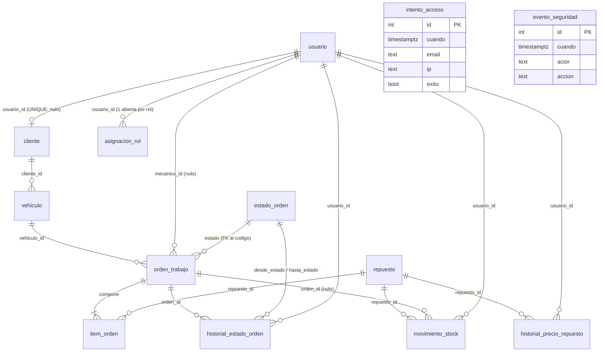

# Modelo de Datos

> **Fuente de verdad**: tabla "Modelo de dominio" de la consigna (págs. 5-6). Los **nombres de tablas y columnas son obligatorios**: los usan los casos de prueba y la corrección. Se pueden **agregar** columnas; no quitar ni renombrar las indicadas.
>
> **Sobre los tipos**: la consigna fija `NUMERIC(10,2)` / `NUMERIC(12,2)`, `timestamptz`, el `CHECK anio BETWEEN 1950 AND 2100` y los `CHECK` de cantidades y precios. Los tipos de las columnas que no explicita (ids enteros autoincrementales, textos, booleanos, `ip`) se marcan **(inferido)** en cada entidad: son decisiones de implementación, no datos del dominio.

## Dominios

| Dominio | Tablas | Qué representa |
|---|---|---|
| Seguridad y personal | `usuario`, `asignacion_rol`, `intento_acceso`, `evento_seguridad` | Quién es quién, qué rol tiene y hasta cuándo, qué intentos de login hubo y qué eventos de seguridad se registraron |
| Clientes | `cliente`, `vehiculo` | Ficha del cliente (con o sin usuario) y sus vehículos, con baja lógica |
| Catálogo e inventario | `repuesto`, `movimiento_stock`, `historial_precio_repuesto` | Repuestos con precio y stock, y los dos historiales de sólo agregado que explican cómo llegaron a ese estado |
| Órdenes de trabajo | `estado_orden`, `orden_trabajo`, `item_orden`, `historial_estado_orden` | El ingreso del vehículo, los repuestos que se van a usar y el recorrido de estados |

**Cantidad de tablas**: la consigna define **13**. El Discovery aprobado y el pedido de esta fase hablan de "12 tablas"; la diferencia es de conteo, no de alcance (probablemente `evento_seguridad`, que no se relaciona con nada, quedó fuera de la cuenta). Se documentan las 13 para no perder ninguna → `IN-01` en `10_preguntas_abiertas.md`.

## ERD (Entity Relationship Diagram)

`intento_acceso` y `evento_seguridad` no se relacionan con ninguna otra tabla (así lo dice la consigna al describir la Figura 1). La relación `asignacion_rol.otorgada_por → usuario.id` existe como FK pero se omitió del diagrama para no dibujar dos vínculos entre las mismas dos entidades.

**Cardinalidades que la consigna remarca:**

| Relación | Cardinalidad | Garantía |
|---|---|---|
| `usuario` ↔ `cliente` | Uno a uno **opcional**: un cliente puede tener o no un usuario, y a lo sumo uno | `cliente.usuario_id` `UNIQUE` y nulo permitido |
| `cliente` → `vehiculo` | Uno a muchos | `vehiculo.cliente_id` `NOT NULL` |
| `vehiculo` → `orden_trabajo` | Uno a muchos | `orden_trabajo.vehiculo_id` `NOT NULL` |
| `estado_orden` → `orden_trabajo` | Uno a muchos (catálogo) | `orden_trabajo.estado` FK a `estado_orden.codigo` |
| `orden_trabajo` → `item_orden` | **Composición**: uno a muchos, el ítem no existe sin su orden | `item_orden.orden_id` `NOT NULL`; los datos de cada ítem viajan dentro del alta de la orden |
| `orden_trabajo` → `historial_estado_orden` | Uno a muchos, sólo agregado | Trigger |
| `repuesto` → `movimiento_stock` | Uno a muchos, sólo agregado | Trigger |
| `repuesto` → `historial_precio_repuesto` | Uno a muchos, sólo agregado | Trigger |
| `usuario` → `asignacion_rol` | Uno a muchos, con vigencia y sin borrado | Índice único parcial |

## Entidades

### `usuario`

| Columna | Tipo | Nulo | Restricción / default |
|---|---|---|---|
| `id` | entero autoincremental PK | no | (inferido) |
| `email` | texto | no | **`UNIQUE`** (RN-01) |
| `nombre` | texto | no | — |
| `password_hash` | texto | no | Hash bcrypt; **nunca** sale en una respuesta |
| `activo` | booleano | no | (inferido) default `true`; `false` → `401` en `get_usuario_actual` |
| `debe_cambiar_password` | booleano | no | (inferido) default `false`; `true` → RN-06 |
| `password_cambiada_en` | `timestamptz` | sí | Con zona horaria; se compara contra `iat` **sin truncar** (RN-07) |

- **Relaciones**: `cliente.usuario_id` (1:1 opcional desde el otro lado); `asignacion_rol.usuario_id`; `orden_trabajo.mecanico_id`; `historial_estado_orden.usuario_id`; `movimiento_stock.usuario_id`; `historial_precio_repuesto.usuario_id`; `asignacion_rol.otorgada_por`.
- **Navegación**: `Usuario.cliente` devuelve **un objeto** (o `None`), no una lista.
- **No tiene** columna `rol`.
- **Constraints**: `email UNIQUE`. No se verifica con consulta previa: se intenta el alta y se traduce el `IntegrityError` a `409`.

### `asignacion_rol`

| Columna | Tipo | Nulo | Restricción / default |
|---|---|---|---|
| `id` | entero autoincremental PK | no | (inferido) |
| `usuario_id` | entero FK → `usuario.id` | no | — |
| `rol` | texto | no | **`CHECK rol IN ('ADMIN','RECEPCION','MECANICO','CLIENTE')`** |
| `desde` | `timestamptz` | no | (inferido) default `now()` |
| `vence_en` | `timestamptz` | sí | Si viene: con zona horaria y en el futuro, si no `422` |
| `revocada_en` | `timestamptz` | sí | Revocar = escribir esta columna; **la fila no se borra nunca** |
| `otorgada_por` | entero FK → `usuario.id` | sí | (inferido) quién otorgó el rol |

- **Índice único parcial**: `(usuario_id, rol) WHERE revocada_en IS NULL` → **a lo sumo una asignación abierta por rol** (RN-03). Se declara en SQLModel con `postgresql_where`.
- **Vigente** = `revocada_en IS NULL AND (vence_en IS NULL OR vence_en > now())`.
- **Reasignar un rol vencido**: cierra la fila anterior (`revocada_en`) y abre una nueva.
- **Índice** sobre `usuario_id` (FK).

### `intento_acceso`

| Columna | Tipo | Nulo | Restricción / default |
|---|---|---|---|
| `id` | entero autoincremental PK | no | (inferido) |
| `cuando` | `timestamptz` | no | (inferido) default `now()` |
| `email` | texto | no | El correo **tal como se escribió**, exista o no el usuario |
| `ip` | texto (o `INET`, inferido) | no | Origen del intento |
| `exito` | booleano | no | `true` login correcto, `false` fallido |

- **Índice compuesto `(email, ip, cuando)`** → es el que sostiene el conteo de RN-08 (5 fallos en 60 s).
- **Sin relaciones**. Se escribe en **sesión y transacción propias**, que se confirman siempre, incluso si el login falla; es la única escritura que no comparte la transacción de su petición.
- **Consecuencia**: deja filas aunque la petición falle; un login correcto no borra los fallos, sólo hace que dejen de contar.

### `evento_seguridad`

| Columna | Tipo | Nulo | Restricción / default |
|---|---|---|---|
| `id` | entero autoincremental PK | no | (inferido) |
| `cuando` | `timestamptz` | no | (inferido) default `now()` |
| `actor` | texto | no | **Texto**, no FK: acepta `SISTEMA` además de emails/ids de usuarios |
| `accion` | texto | no | Descripción del evento |

- **Sin restricciones extra** y **sin relaciones** (consigna).
- Registra altas de usuario, cambios de rol, cambios de contraseña y la carga inicial con `actor = 'SISTEMA'`.
- Se consulta con `GET /eventos` (ADMIN, paginado). No tiene endpoint de escritura: lo escriben los servicios.

### `cliente`

| Columna | Tipo | Nulo | Restricción / default |
|---|---|---|---|
| `id` | entero autoincremental PK | no | (inferido) |
| `usuario_id` | entero FK → `usuario.id` | **sí** | **`UNIQUE`** (1:1 opcional) |
| `nombre` | texto | no | — |
| `documento` | texto | no | **`UNIQUE`** (RN-01) |
| `telefono` | texto | no | (inferido) |

- Un cliente **puede no tener usuario** (Jorge en el seed) y **a lo sumo uno**.
- `POST /clientes` crea la ficha; el auto-registro crea la ficha + usuario + rol en un solo UoW (RN-02).
- Si el documento ya existe, `409` **y no se apropia de la ficha**.
- **Índice** sobre `usuario_id` (FK + UNIQUE).

### `vehiculo`

| Columna | Tipo | Nulo | Restricción / default |
|---|---|---|---|
| `id` | entero autoincremental PK | no | (inferido) |
| `cliente_id` | entero FK → `cliente.id` | no | — |
| `patente` | texto | no | — |
| `marca` | texto | no | (inferido) |
| `modelo` | texto | no | (inferido) |
| `anio` | entero | no | **`CHECK anio BETWEEN 1950 AND 2100`** |
| `borrado_en` | `timestamptz` | sí | Baja lógica; nulo = vigente |

- **Índice único parcial** `(patente) WHERE borrado_en IS NULL`: la patente es única **sólo entre los vigentes**. Un auto vendido se da de baja y el comprador lo registra con la misma patente (C-19).
- Un vehículo con **órdenes abiertas** (estado con `es_final = false`) **no se da de baja** → `409` (RN-16).
- Un vehículo dado de baja no aparece en listados y no se puede usar en órdenes nuevas.
- **Índice** sobre `cliente_id` (FK).

### `repuesto`

| Columna | Tipo | Nulo | Restricción / default |
|---|---|---|---|
| `id` | entero autoincremental PK | no | (inferido) |
| `codigo` | texto | no | — |
| `descripcion` | texto | no | — |
| `precio` | `NUMERIC(10,2)` | no | **`CHECK precio > 0`**; en Python `Decimal` |
| `stock` | entero | no | **`CHECK stock >= 0`**; sólo cambia por movimientos (RN-14) |
| `borrado_en` | `timestamptz` | sí | Baja lógica |

- **Índice único parcial** `(codigo) WHERE borrado_en IS NULL`.
- `stock_inicial` en el alta **no es una columna**: es un campo del contrato de entrada que se convierte en un `movimiento_stock` con motivo `"Stock inicial"` y `orden_id = NULL`.
- `PATCH` acepta **descripción y precio**; el stock no (`extra="forbid"` → `422`).
- **Sin índice extra** (la PK y el índice parcial alcanzan); sí índice en las tablas que lo referencian.

### `estado_orden` (catálogo)

| Columna | Tipo | Nulo | Restricción / default |
|---|---|---|---|
| `codigo` | texto **PK** | no | La PK es el código, no un `id` |
| `descripcion` | texto | no | Texto libre; **la consigna no fija los textos** |
| `posicion` | entero | no | **`UNIQUE`**; ordena el catálogo |
| `es_final` | booleano | no | `TERMINADA` y `CANCELADA` son finales |

- **Catálogo**: apuntado por FK desde `orden_trabajo.estado` y desde `historial_estado_orden.desde_estado` / `hasta_estado`. **No** es un `CHECK` con la lista adentro.
- La migración crea la tabla **vacía**; sus 4 filas las carga `seed.py`. Sin filas **no se puede crear ninguna orden** → `409` (RN-19).
- Se consulta con `GET /estados-orden` (ordenado por `posicion`) y **no se edita por API**.
- El código en Python es un `enum`, que es el contrato de la API (un estado no declarado → `422`) y el vocabulario de las transiciones. Enum y catálogo tienen que coincidir.
- Repositorio **propio de sólo lectura**, que **no hereda** de `BaseRepository` (su PK no es `id` y no debe ofrecer `add`/`update`/`delete`).

### `orden_trabajo`

| Columna | Tipo | Nulo | Restricción / default |
|---|---|---|---|
| `id` | entero autoincremental PK | no | (inferido) |
| `vehiculo_id` | entero FK → `vehiculo.id` | no | — |
| `mecanico_id` | entero FK → `usuario.id` | sí | Se asigna al iniciar (RN-11) |
| `estado` | texto FK → `estado_orden.codigo` | no | Nace `PENDIENTE` |
| `falla` | texto | no | Lo que describe el cliente |
| `creada_en` | `timestamptz` | no | (inferido) default `now()` |
| `total` | `NUMERIC(12,2)` | no | **`CHECK total >= 0`**; lo calcula el servidor |

- **Composición** con `item_orden`: la orden nace con al menos un ítem; un ítem no existe sin su orden.
- `total` = suma de `cantidad * precio_unitario` de sus ítems, calculado por el servidor. **Nunca** viaja en el cuerpo del alta.
- **Índices** sobre `vehiculo_id`, `mecanico_id` y `estado` (FKs).
- Estados posibles: `PENDIENTE` → `EN_REPARACION` → `TERMINADA`; `PENDIENTE` → `CANCELADA`.

### `item_orden`

| Columna | Tipo | Nulo | Restricción / default |
|---|---|---|---|
| `id` | entero autoincremental PK | no | (inferido) |
| `orden_id` | entero FK → `orden_trabajo.id` | no | — |
| `repuesto_id` | entero FK → `repuesto.id` | no | — |
| `cantidad` | entero | no | **`CHECK cantidad > 0`** |
| `precio_unitario` | `NUMERIC(10,2)` | no | **`CHECK precio_unitario > 0`**; copiado del repuesto al crear |

- **`UNIQUE (orden_id, repuesto_id)`** → un repuesto no se repite en la misma orden (RN-10). Un body con el mismo repuesto dos veces choca con la base (`409`).
- `precio_unitario` se **copia** del repuesto en el momento del alta: si el repuesto cambia de precio después, la orden conserva el precio histórico.
- **Índices** sobre `orden_id` y `repuesto_id` (FKs).

### `historial_estado_orden` (sólo agregado)

| Columna | Tipo | Nulo | Restricción / default |
|---|---|---|---|
| `id` | entero autoincremental PK | no | (inferido) |
| `orden_id` | entero FK → `orden_trabajo.id` | no | — |
| `desde_estado` | texto FK → `estado_orden.codigo` | **sí** | Nulo en la primera línea (la orden "nace") |
| `hasta_estado` | texto FK → `estado_orden.codigo` | no | — |
| `usuario_id` | entero FK → `usuario.id` | no | Quién produjo la transición |
| `cuando` | `timestamptz` | no | (inferido) default `now()` |

- **Sólo agregado**: el disparador de la segunda migración rechaza cualquier `UPDATE` o `DELETE`, venga de donde venga (RN-15).
- **Índices** sobre `orden_id`, `desde_estado`, `hasta_estado`, `usuario_id`.
- La primera línea del alta es `(null → PENDIENTE)` y la escribe el usuario que creó la orden (`SISTEMA` no puede: `usuario_id` es `NOT NULL`).

### `movimiento_stock` (sólo agregado)

| Columna | Tipo | Nulo | Restricción / default |
|---|---|---|---|
| `id` | entero autoincremental PK | no | (inferido) |
| `repuesto_id` | entero FK → `repuesto.id` | no | — |
| `orden_id` | entero FK → `orden_trabajo.id` | **sí** | Nulo en stock inicial y reposición; no nulo al terminar una orden |
| `usuario_id` | entero FK → `usuario.id` | no | Quién generó el movimiento |
| `cantidad` | entero | no | **`CHECK cantidad > 0`** (en el PDF se extrae como `>>`); el signo lo da el `motivo` |
| `motivo` | texto | no | `"Stock inicial"`, `"Reposición"`, `"Consumo en orden"` (estos dos últimos inferidos) |
| `cuando` | `timestamptz` | no | (inferido) default `now()` |

- **Sólo agregado** (RN-15).
- Es el **único** camino por el que cambia `repuesto.stock` (RN-14): alta con stock inicial, reposición y terminación. Nunca un `PATCH`.
- **Índices** sobre `repuesto_id`, `orden_id`, `usuario_id`.

### `historial_precio_repuesto` (sólo agregado)

| Columna | Tipo | Nulo | Restricción / default |
|---|---|---|---|
| `id` | entero autoincremental PK | no | (inferido) |
| `repuesto_id` | entero FK → `repuesto.id` | no | — |
| `usuario_id` | entero FK → `usuario.id` | no | Quién cambió el precio |
| `precio_anterior` | `NUMERIC(10,2)` | no | — |
| `precio_nuevo` | `NUMERIC(10,2)` | no | **`CHECK precio_nuevo > 0`** |
| `cuando` | `timestamptz` | no | (inferido) default `now()` |

- **`CHECK precio_nuevo > precio_anterior`** → el historial sólo registra **aumentos**. Un `PATCH` que baja el precio choca con la base: el servicio debe traducirlo (`422`/`409`, ver `10_preguntas_abiertas.md`).
- **Sólo agregado** (RN-15). Se escribe **en la misma transacción** que el cambio de precio (RN-20); un `PATCH` que no cambia el precio no deja línea.
- **Índices** sobre `repuesto_id` y `usuario_id`.

## Índices y restricciones — resumen

| Tabla | Restricción | Tipo | Definición |
|---|---|---|---|
| `usuario` | email único | `UNIQUE` | `email` |
| `cliente` | usuario 1:1 | `UNIQUE` | `usuario_id` (nulo permitido) |
| `cliente` | documento único | `UNIQUE` | `documento` |
| `asignacion_rol` | una abierta por rol | **índice único parcial** | `(usuario_id, rol) WHERE revocada_en IS NULL` |
| `asignacion_rol` | roles válidos | `CHECK` | `rol IN ('ADMIN','RECEPCION','MECANICO','CLIENTE')` |
| `vehiculo` | patente única entre vigentes | **índice único parcial** | `(patente) WHERE borrado_en IS NULL` |
| `vehiculo` | año plausible | `CHECK` | `anio BETWEEN 1950 AND 2100` |
| `repuesto` | código único entre vigentes | **índice único parcial** | `(codigo) WHERE borrado_en IS NULL` |
| `repuesto` | precio y stock | `CHECK` | `precio > 0`, `stock >= 0` |
| `estado_orden` | posición única | `UNIQUE` | `posicion` |
| `orden_trabajo` | total no negativo | `CHECK` | `total >= 0` |
| `orden_trabajo` | estado válido | **FK** | `estado → estado_orden.codigo` |
| `item_orden` | cantidad y precio | `CHECK` | `cantidad > 0`, `precio_unitario > 0` |
| `item_orden` | sin repuestos repetidos | `UNIQUE` | `(orden_id, repuesto_id)` |
| `historial_estado_orden` | estados válidos | **FK** | `desde_estado`, `hasta_estado → estado_orden.codigo` |
| `movimiento_stock` | cantidad positiva | `CHECK` | `cantidad > 0` |
| `historial_precio_repuesto` | precio nuevo válido | `CHECK` | `precio_nuevo > 0`, `precio_nuevo > precio_anterior` |
| `intento_acceso` | conteo de RN-08 | índice | `(email, ip, cuando)` |

**Los tres índices únicos parciales** (los que pide el Ej. 2, con `postgresql_where`) son: `asignacion_rol (usuario_id, rol)`, `vehiculo (patente)` y `repuesto (codigo)`.

**Toda clave foránea lleva índice propio** (PostgreSQL no lo crea solo). Las tablas de sólo agregado no llevan índice extra por fecha: no se consultan por rango.

## Seed data inicial

`seed.py` **vacía las tablas y deja la base en un estado inicial conocido**; los 19 casos de prueba dependen de él. Se corre `python seed.py` antes de cada archivo `.http`. No es un extra de prueba: **el catálogo de estados es parte de la puesta en marcha** — sin sus filas no se puede crear ninguna orden.

- **Vaciado**: `TRUNCATE ... RESTART IDENTITY CASCADE` (corregido en C-02, OQ-1: un `DELETE` sobre las tablas de sólo agregado lo rechaza el disparador; `TRUNCATE` no activa disparadores de fila).
- **Contraseñas**: ficticias y viven **sólo** en `seed.py`; no se documentan acá ni en el repo.

| Qué | Datos |
|---|---|
| **Catálogo de estados** (primero) | `PENDIENTE` (posición 1), `EN_REPARACION` (2), `TERMINADA` (3, final), `CANCELADA` (4, final), cada uno con su descripción |
| **Usuarios (7)** | `admin@example.com` (ADMIN), `admin2@example.com` (ADMIN), `recepcion@example.com` (RECEPCION), `mecanico@example.com` (MECANICO), `mecanico2@example.com` (MECANICO), `cliente@example.com` (CLIENTE), `nuevo@example.com` (MECANICO, **con cambio de contraseña obligatorio**) |
| **Clientes (2)** | **Laura**, con usuario (`cliente@example.com`) y **2 vehículos**; **Jorge**, **sin usuario**, con **1 vehículo** |
| **Repuestos (4)** | Filtro de aceite (**stock 10**), pastillas de freno (**4**), bujía (**2**), aceite por litro (**20**). Cada stock se carga como un movimiento `"Stock inicial"` |
| **Órdenes (2)** | **Orden 1**: `PENDIENTE`, del **primer vehículo de Laura**. **Orden 2**: `EN_REPARACION`, del **vehículo de Jorge**, asignada a `mecanico@example.com`, con **4 bujías cuando hay 2** |
| **Historial de precios (1)** | Una línea del **filtro de aceite**: de **8000** a **8500** |
| **Historial de seguridad (1)** | Una línea con `actor = 'SISTEMA'`: `"Carga de los datos iniciales"` |

### La orden 2 tiene 4 bujías con stock 2 **a propósito**

No es un error de carga: es el escenario del caso **C-11**. Al intentar terminarla, el servicio detecta que no alcanza el stock y responde **409 sin escribir nada** — el estado, el stock, los movimientos y el historial quedan exactamente como estaban (RN-13). Después del `POST /repuestos/{id}/reponer` correspondiente, el caso **C-12** termina la orden con éxito y verifica el descuento, los movimientos, la línea de historial y el aviso en el log.

**Crear** la orden 2 no choca con nada: el stock se descuenta **al terminar**, no al crear. Por eso el seed puede dejarla en `EN_REPARACION` con 4 bujías y stock 2.

### Datos que la consigna **no** fija (no inventar)

| Dato | Estado |
|---|---|
| Patentes, marcas, modelos y años de los 3 vehículos | **No definidos**. En los ejemplos de respuesta aparece `AC456EF`, pero es un ejemplo, no dato de seed |
| Documentos y teléfonos de Laura y Jorge | **No definidos** |
| Códigos de los 4 repuestos | **No definidos como seed**. `FIL-001`, `FRE-010` y `ACE-530` aparecen en respuestas de ejemplo |
| Precios de los repuestos | Sólo se fija el del filtro: **8500** (por el historial 8000 → 8500). Los demás no |
| Descripciones exactas de los 4 estados | **No definidas** (sólo "cada uno con su descripción") |
| Ítems y totales de las órdenes 1 y 2 | Sólo se sabe que la 2 lleva 4 bujías |
| Líneas de historial de las órdenes 1 y 2 | No enumeradas. Coherente con el flujo: 1 línea para la orden 1 (`null → PENDIENTE`) y 2 para la 2 (`null → PENDIENTE`, `PENDIENTE → EN_REPARACION`) — **suposición** |
| Usuario que firma los movimientos de stock inicial y el cambio de precio | No definido; **suposición**: `admin@example.com` |

Todo esto va a `10_preguntas_abiertas.md`. Mientras no se resuelva, el equipo puede elegir valores ficticios **siempre que sean consistentes con los 19 casos** (por ejemplo: `C-10` espera dos ítems con precios copiados; `C-19` espera registrar la misma patente tras una baja).
